# Orcon 15RF Controller

**Bedien je Orcon-ventilatie met een Heltec WiFi LoRa 32 V2 — via een eigen webinterface, zonder cloud.**

Lees een bestaande Orcon 15RF-afstandsbediening uit, bewaar profielen en gebruik de Heltec als virtuele afstandsbediening. De Nederlandse handleiding hieronder neemt je stap voor stap mee, van de eerste USB-installatie tot bediening, updates en herstel.

*An open-source, local web controller for compatible Orcon HRC/MVS ventilation units with a 15RF remote. The visual guide below is in Dutch.*

  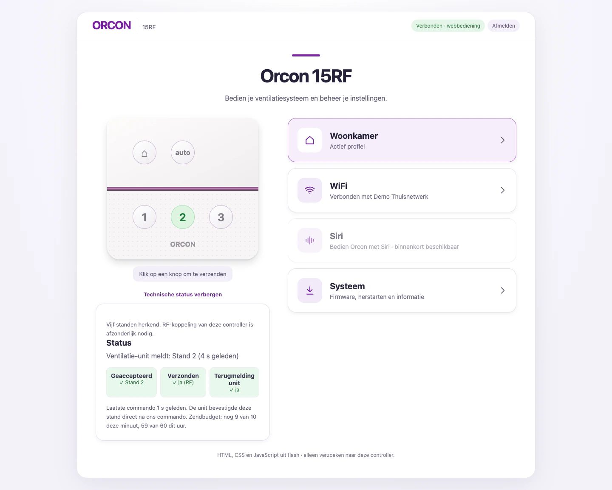

De echte ontwikkelinterface, met fictieve demonstratiegegevens. Alle opnames gebruiken een desktopviewport van 1440 × 900; de kleinere uitsnede is een aanvullende detailweergave.

> **Belangrijk voor nieuwe gebruikers**
>
> Er is op dit moment **nog geen officiële firmware-release** op GitHub. De beveiligde webbediening staat in een open pull request; de installatiewizard, persoonlijke herstelsleutel, webupdates en het fysieke herstelmenu staan op een ontwikkelbranch. Die laatste onderdelen zijn host-getest, maar **nog niet op echte hardware gevalideerd**. Zie [Projectstatus](#projectstatus).

## Wat kun je ermee?

- **Ventilatie bedienen:** kies Woning, Auto of Stand 1–3 met de virtuele afstandsbediening.
- **Een bestaande afstandsbediening uitlezen:** de wizard herkent zes knoppen en slaat de gegevens in een profiel op.
- **Daarna zonder originele afstandsbediening werken:** koppel de Heltec met een eigen identiteit; voor de huidige control-build is wel een eenmalig volledig uitgelezen profiel nodig.
- **Profielen gebruiken:** bewaar maximaal vier profielen en kies welke actief is.
- **Lokaal beheer:** wifi, OLED-scherm, beveiligde login en systeeminformatie in de browser.
- **Updates en herstel:** ondertekende `.orconfw`-updates, automatische terugval en fysieke herstelopties in de ontwikkelversie.

Niet beschikbaar: Siri-bediening, automatisch zoeken naar updates en een webknop voor een fabrieksreset.

## Inhoudsopgave

Kies een hoofdstuk. Je komt bij een zichtbare kop; **klap daarna het hoofdstuk direct eronder open**.

1. [Installatie](#installatie)
2. [Eerste configuratie](#eerste-configuratie)
3. [WiFi configureren](#wifi-configureren)
4. [Afstandsbediening uitlezen](#afstandsbediening-uitlezen)
5. [Afstandsbediening simuleren](#afstandsbediening-simuleren)
6. [Profielen beheren](#profielen-beheren)
7. [Firmware bijwerken](#firmware-bijwerken)
8. [Resetten en herstellen](#resetten-en-herstellen)
9. [Problemen oplossen](#problemen-oplossen)
10. [Technische informatie](#technische-informatie)

---

## Installatie

<strong>Installatie — handleiding openen</strong>

### 1. Controleer je Heltec

Deze handleiding is uitsluitend bedoeld voor de:

- **Heltec WiFi LoRa 32 V2**;
- klassieke **ESP32** met **SX1276**-radio;
- **868 MHz**-versie, met de bijbehorende antenne;
- micro-USB-aansluiting en OLED-scherm.

> **Let op het model en de frequentie.** Heltec V3/V4, SX1262-borden en 433 MHz-versies zijn geen ondersteunde vervangers voor deze handleiding. Gebruik geen firmware voor een ander bord of een andere radio.

### 2. Wat heb je nodig?

- De juiste Heltec en antenne.
- Eenmalig een computer met **Chrome of Edge**.
- Een **micro-USB-datakabel**. Een kabel die alleen oplaadt, werkt niet.
- Een telefoon of computer met wifi en een browser.
- De naam en het wachtwoord van je **2,4 GHz**-wifinetwerk.
- Bij voorkeur de originele Orcon 15RF-afstandsbediening; die is niet verplicht als je de Heltec zelf wilt koppelen.

### 3. Firmware downloaden

De bedoelde downloadlocatie is de [releasepagina van dit project](../../releases). Daar staat nu nog geen officiële release. Download dus geen willekeurig `.bin`-bestand uit een buildmap of van een andere bron.

Voor een toekomstige eerste release is de bedoelde bestandsnaam:

`orcon-controller-heltec-v2-factory.bin`

Dit is het complete pakket voor de **eenmalige USB-installatie**. Het is niet hetzelfde als een `.orconfw`-updatebestand. De releaseprocedure is nog een voorstel; zie [Releases en GitHub-integratie](docs/RELEASES.md).

### 4. Eenmalig installeren via USB

**Deze stappen gelden pas zodra het genoemde factory-bestand als officiële release beschikbaar is.** Er is nog geen gevalideerde éénklikinstallatie.

1. Sluit de Heltec met de datakabel op de computer aan.
2. Open in Chrome of Edge de [officiële Espressif-webflasher](https://espressif.github.io/esptool-js/).
3. Kies **Connect** en selecteer de USB-poort van de Heltec.
4. Kies `orcon-controller-heltec-v2-factory.bin` en zet het bijbehorende adres op **`0x0`**.
5. Start **Program** en wacht tot het schrijven volledig klaar is.
6. Druk daarna één keer kort op **RST** op de Heltec.

Wordt geen poort gevonden? Probeer eerst een andere datakabel of USB-poort. Op Windows kan de CP210x-driver van Silicon Labs nodig zijn. Houd **PRG niet ingedrukt terwijl je RST indrukt**: daardoor kan het bord in de downloadmodus starten met een zwart scherm.

Ontwikkelaars die zelf een ontwikkelbuild willen maken, vinden de afzonderlijke, beveiligde bouw- en flashprocedure in [Lokale USB-release](docs/LOCAL_USB_RELEASE.md). Die procedure is geen beginnersinstallatie en mag niet zonder controle op een werkende Heltec worden uitgevoerd.

### 5. Eerste opstart en telefoon verbinden

In de ontwikkelversie van de installatiewizard:

1. Het OLED toont **Installatie**, het netwerk **`Orcon15RF-Setup`** en een uniek wachtwoord van **12 tekens**.
2. Open de wifi-instellingen op je telefoon en verbind met **`Orcon15RF-Setup`**.
3. Voer het wachtwoord van het OLED in. Het is geen algemeen fabriekswachtwoord.
4. De installatiepagina opent meestal vanzelf. Open anders zelf **http://192.168.4.1** in Safari of Chrome.
5. Ga verder met [Eerste configuratie](#eerste-configuratie) en klap daar het hoofdstuk open.

Je telefoon kan melden dat dit netwerk geen internet heeft. Dat is normaal: je bent rechtstreeks met de Heltec verbonden. Blijf tijdens de installatie met dit netwerk verbonden. Gebruik voor het downloaden van de herstelsleutel bij voorkeur de gewone browser in plaats van het kleine inlogvenster van de telefoon.

> Het OLED kan na 30 seconden uitgaan. Druk in de normale schermstanden kort op **PRG** om het weer tijdelijk te tonen. Bij een actief setup-netwerk blijft het scherm volgens het huidige ontwerp aan zodat het setup-wachtwoord leesbaar blijft.

### USB-installatie en latere updates zijn verschillend

| Moment | Methode | Bestand |
| --- | --- | --- |
| Eerste installatie, of herstel van de OTA-ontvanger | Eenmalig via USB | Factory-`.bin`, zodra officieel uitgebracht |
| Latere firmware-update | Via wifi in **Systeem → Firmware** | Ondertekende `.orconfw`-bundel |

### OLED-weergave instellen

Open in de ontwikkelinterface **Systeem → OLED-scherm**. Kies **Altijd aan**, **Automatisch: uit na 30 seconden** of **Uit**. **Scherm nu aan of uit** verandert alleen de huidige weergave, niet de opgeslagen stand. Wifi en radio-ontvangst blijven actief als het scherm uit is.

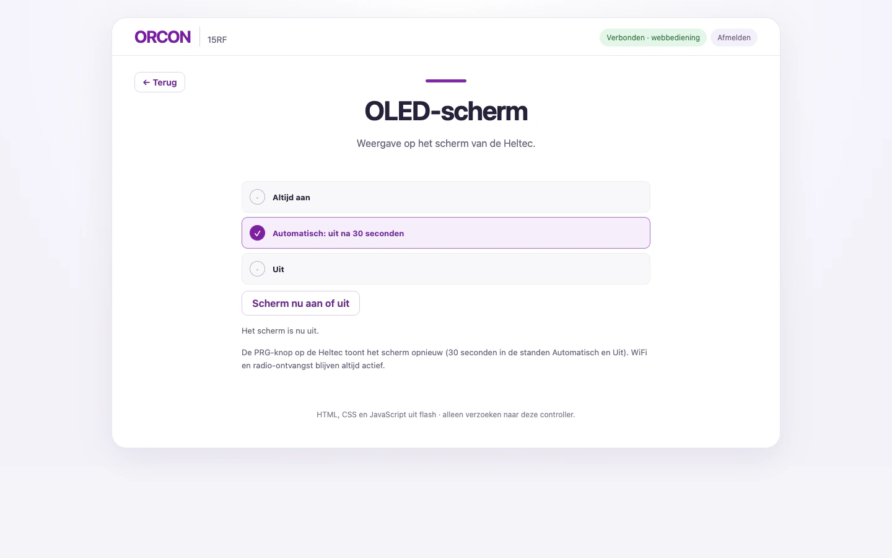

Er is nog geen echte foto van het OLED- of herstelmenu in de repository. De afbeelding hierboven toont uitsluitend de bestaande webinstellingen.

## Eerste configuratie

<strong>Eerste configuratie — wizard in vier stappen openen</strong>

> **Ontwikkelversie — niet op hardware gevalideerd.** Deze wizard en de persoonlijke herstelsleutel staan niet in een officiële release. De schermen hieronder komen uit de echte HTML, CSS en JavaScript van `feature/plug-and-play-setup`; de getoonde gegevens zijn fictief.

Open **http://192.168.4.1** terwijl je met **`Orcon15RF-Setup`** bent verbonden.

### Stap 1 — Wachtwoord aanmaken

1. Kies een beheerderswachtwoord van **8 tot 64 tekens**.
2. Vul het twee keer in en kies **Volgende**.

Dit wachtwoord beschermt de bediening, profielen en instellingen. Er is geen standaardwachtwoord. De controller bewaart geen leesbaar wachtwoord, maar een beveiligde afgeleide waarde.

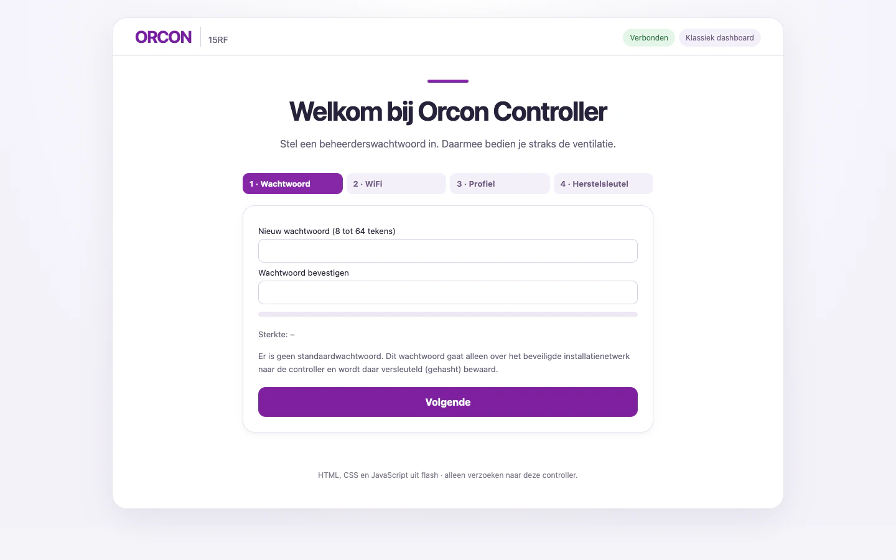

### Stap 2 — WiFi instellen

1. Kies **Scannen**.
2. Selecteer je thuisnetwerk in **Beschikbare netwerken**. Bij een verborgen netwerk typ je de naam zelf bij **Netwerknaam (SSID)**.
3. Vul het wifi-wachtwoord in.
4. Kies **Verbinding testen**.

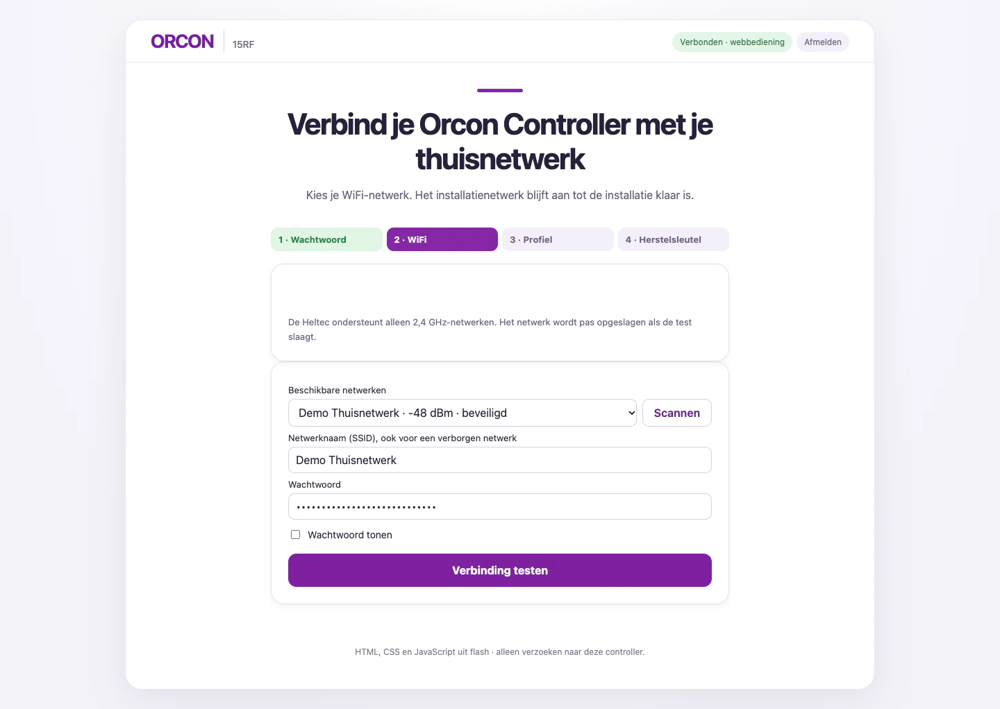

De controller ondersteunt alleen **2,4 GHz**. Het netwerk wordt pas opgeslagen nadat de verbindingstest is geslaagd. Bij een fout wachtwoord blijft de oude configuratie behouden.

Tijdens de test kan de telefoon de verbinding met de Heltec kort verliezen. Verbind dan opnieuw met `Orcon15RF-Setup`; de pagina gaat verder zodra de verbinding terug is.

### Stap 3 — Profiel maken

Kies een herkenbare naam, bijvoorbeeld **Woonkamer** of **Zolder**. Daarna zijn er twee verschillende mogelijkheden:

- **Afstandsbediening uitlezen:** lees de zes knoppen van je bestaande Orcon-afstandsbediening en sla ze op in het profiel.
- **Koppelen met de ventilatie-unit:** laat de Heltec als virtuele afstandsbediening met de unit communiceren.

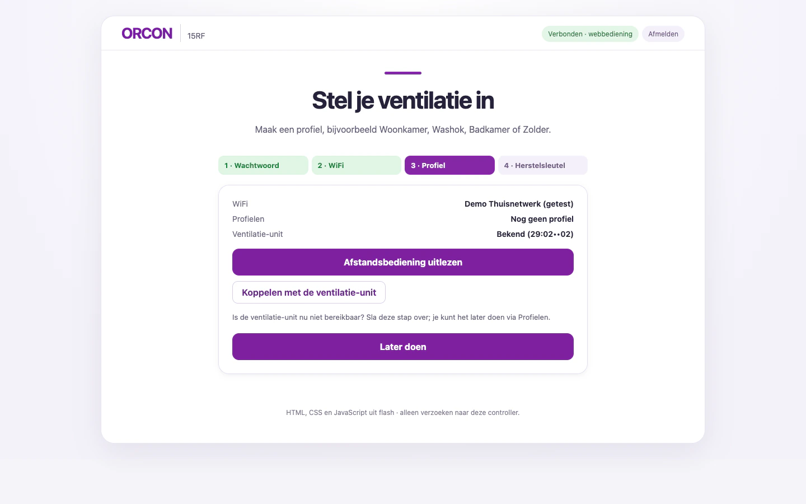

Is de ventilatie-unit nu niet bereikbaar? Kies **Later doen**. Je kunt het profiel later via **Profielen** aanmaken. De uitgebreide stappen staan in [Afstandsbediening uitlezen](#afstandsbediening-uitlezen) en [Afstandsbediening simuleren](#afstandsbediening-simuleren).

### Stap 4 — Persoonlijke herstelsleutel downloaden

De persoonlijke herstelsleutel is een bestand dat bewijst dat jij de eigenaar van deze controller bent. Je gebruikt het alleen om een vergeten beheerderswachtwoord te herstellen of om een nieuwe sleutel te maken tijdens de fysieke herstelmodus.

1. Kies een wachtwoordzin van **10 tot 64 tekens**, anders dan je beheerderswachtwoord.
2. Kies **Sleutel maken**. Dit kan even duren.
3. Download **`orcon-recovery-key.pem`**. Werkt downloaden in het kleine inlogvenster niet, gebruik dan **Tekst kopiëren** of open de pagina in Safari of Chrome.
4. Bewaar het bestand en de wachtwoordzin **apart en veilig**, bijvoorbeeld in een wachtwoordmanager.
5. Selecteer het opgeslagen bestand of plak de tekst terug in het controleveld.
6. Vul de wachtwoordzin in en kies **Controleren en afronden**.

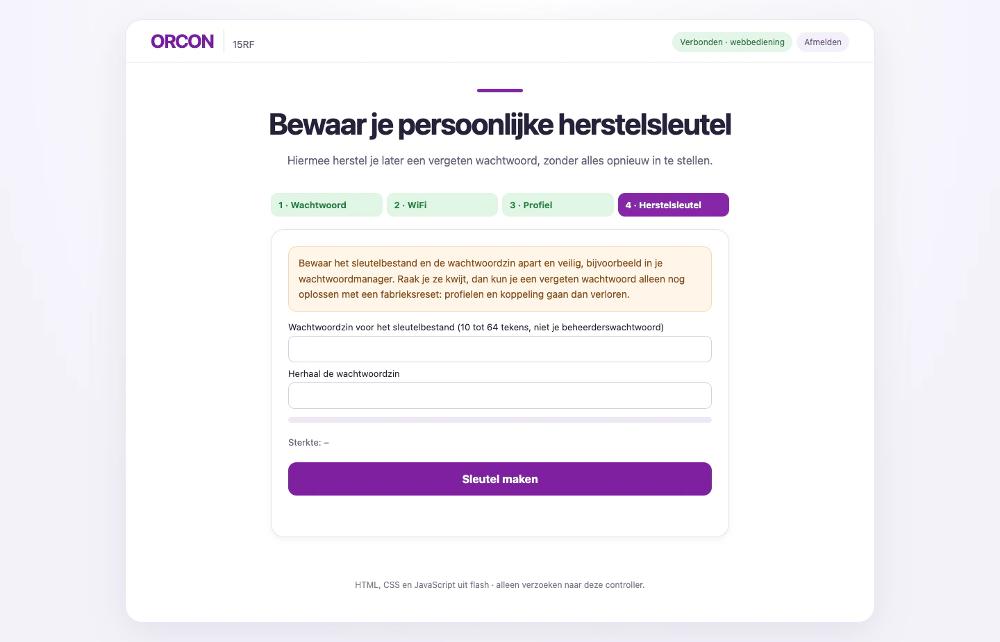

De controller laat de installatie pas afronden nadat het opgeslagen bestand en de wachtwoordzin succesvol zijn gecontroleerd. Er wordt hier bewust geen echte PEM-sleutel afgebeeld.

> **Deel dit bestand en de wachtwoordzin niet.** Wie beide heeft en fysiek bij de Heltec kan komen, kan het beheerderswachtwoord herstellen. Ben je het bestand én de wachtwoordzin kwijt, dan kun je nog gewoon aanmelden zolang je het beheerderswachtwoord weet. Vergeet je dat wachtwoord ook, dan resteert alleen een fabrieksreset.

**Technisch, voor wie meer wil weten:** het PEM-bestand bevat een versleutelde persoonlijke privésleutel. De controller maakt die lokaal, bewaart alleen het publieke deel en verwijdert het private deel uit zijn eigen geheugen. Het bestand is geen firmwaresleutel en kan geen updates ondertekenen. Details staan in [Installatie, eigendom en herstel](docs/PROVISIONING.md).

### Klaar en aanmelden

De controller start opnieuw en verbindt met het geteste thuisnetwerk.

1. Verbind je telefoon of computer weer met dat thuisnetwerk.
2. Open **http://orcon15rf.local** of het IP-adres dat het scherm **Klaar** toont.
3. Meld je aan met je beheerderswachtwoord.

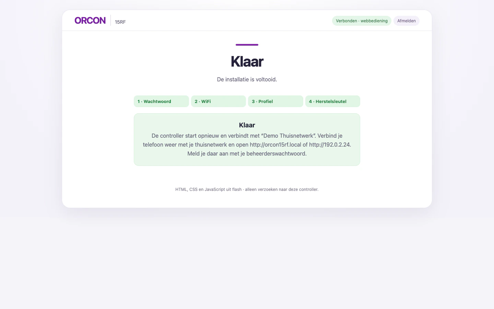

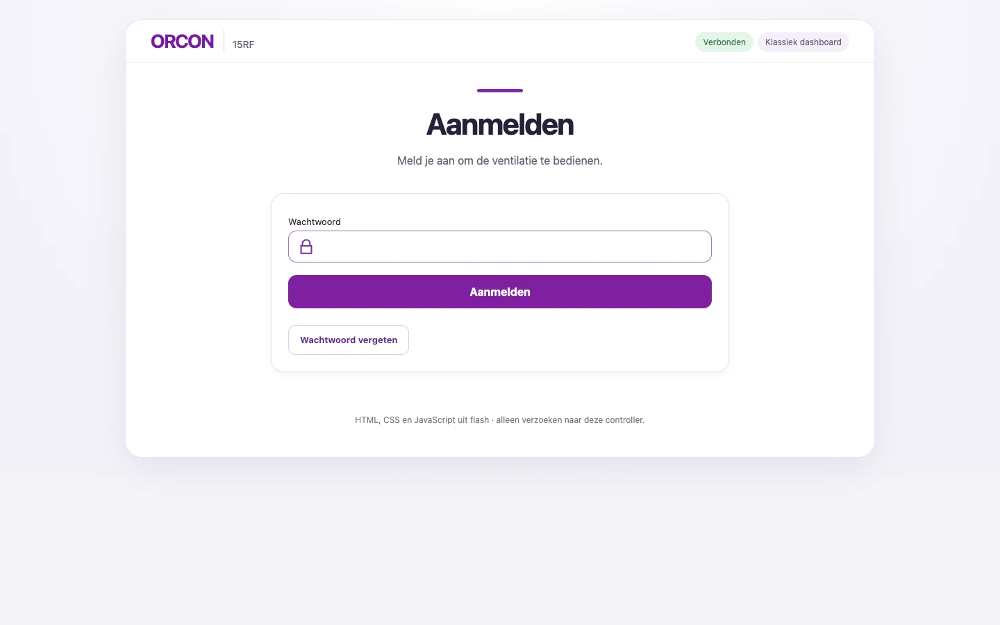

Gebruik de webinterface alleen op een vertrouwd thuisnetwerk. In de huidige ontwikkelversie gebruikt de verbinding op dat netwerk HTTP zonder TLS. De ontbrekende LAN-versleuteling is een van de releaseblokkades; zie [Projectstatus](#projectstatus).

## WiFi configureren

<strong>WiFi configureren — handleiding openen</strong>

### Netwerk zoeken, verbinden of van router wisselen

1. Meld je aan en open **WiFi** op het dashboard.
2. Kies **Nieuw WiFi-netwerk instellen**.

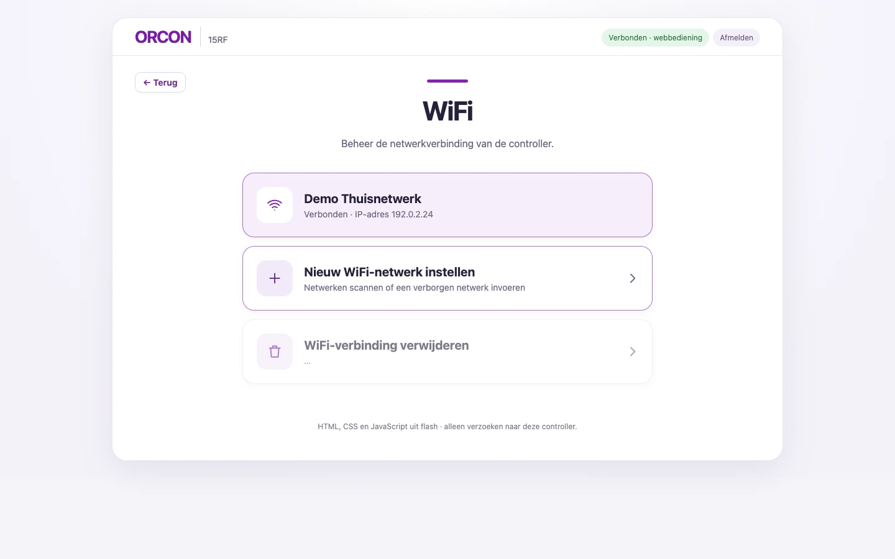

3. Kies **Scannen** en selecteer het nieuwe netwerk. Typ bij een verborgen netwerk de exacte naam in het veld **Netwerknaam (SSID)**.
4. Vul het wifi-wachtwoord in.
5. Kies **Opslaan en herstarten**.

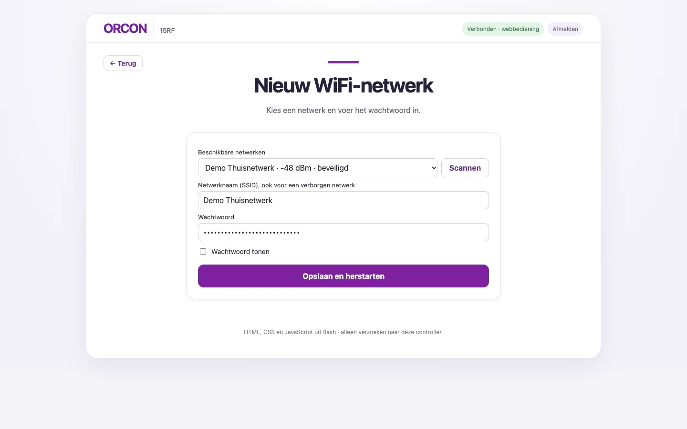

De controller herstart en probeert het gekozen netwerk te gebruiken. Open daarna opnieuw **http://orcon15rf.local** of het nieuwe IP-adres. Controleer zo nodig in je router welk adres is toegekend.

**Alleen het wifi-wachtwoord wijzigen:** volg dezelfde stappen, kies opnieuw dezelfde netwerknaam en voer het nieuwe wachtwoord in. Laat je in dit gewone wijzigingsscherm het wachtwoord leeg, dan behoudt de controller het bestaande wachtwoord. Gebruik dit scherm daarom niet om een bestaand beveiligd netwerk in een open netwerk te veranderen.

### Een netwerk vergeten

1. Open **WiFi → WiFi-verbinding verwijderen**.
2. Bevestig de keuze.
3. De controller wist het thuisnetwerk, herstart en maakt `Orcon15RF-Setup` beschikbaar.
4. Verbind met dat netwerk en open **http://192.168.4.1** om opnieuw in te stellen.

Profielen, het beheerderswachtwoord, de herstelsleutel, OLED-instellingen en RF-gegevens blijven hierbij behouden.

### Geen toegang meer tot de Heltec?

Is het opgeslagen thuisnetwerk bij het opstarten niet binnen ongeveer **15 seconden** bereikbaar, dan start de ontwikkelversie het noodnetwerk `Orcon15RF-Setup`. Het wachtwoord staat op het OLED. Open daarna **http://192.168.4.1**, meld je aan en stel wifi opnieuw in.

De controller blijft het oude thuisnetwerk op de achtergrond opnieuw proberen, behalve terwijl iemand met het noodnetwerk is verbonden. Zet de router dus eerst aan en wacht even voordat je gegevens wist.

## Afstandsbediening uitlezen

<strong>Afstandsbediening uitlezen — handleiding openen</strong>

### Eerst het verschil: uitlezen is niet koppelen

| Wat wil je doen? | Functie in de interface | Resultaat |
| --- | --- | --- |
| **A.** De knoppen van een bestaande fysieke Orcon-afstandsbediening leren | **Afstandsbediening koppelen**, gevolgd door het uitleesscherm | Een profiel met de herkende afstandsbediening en knoppen |
| **B.** De Heltec zelf als afstandsbediening gebruiken | **Simulatie instellen** | Een aparte RF-koppeling tussen de eigen Heltec-identiteit en de ventilatie-unit |

Uitlezen verandert niets aan de koppeling van de Heltec. Ook een opgeslagen profiel betekent niet automatisch dat de Heltec opdrachten naar de unit mag of kan sturen.

### 1. Laat de controller je afstandsbediening zien

1. Houd de originele afstandsbediening in de buurt van de Heltec.
2. Druk één keer op een ondersteunde knop.
3. Open het profiel of de installatiekeuze en kies **Afstandsbediening koppelen**.
4. Selecteer onder **Kies je afstandsbediening** het apparaat dat zojuist verscheen. De controller kiest nooit zelf een afstandsbediening.

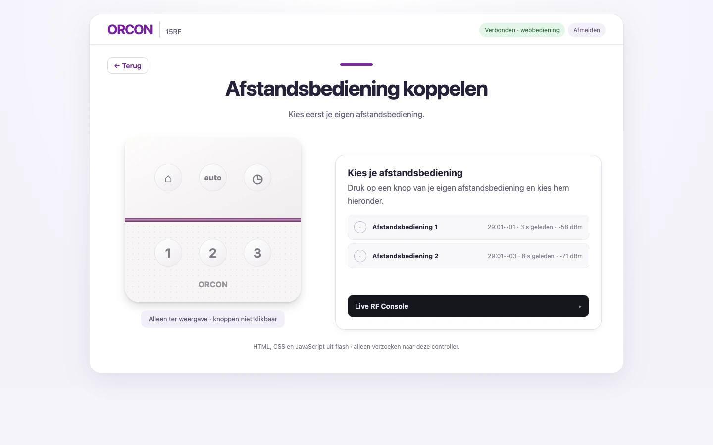

### 2. Lees alle zes knoppen uit

Start het uitlezen en druk alleen wanneer de pagina daarom vraagt op:

1. **Woning**;
2. **Auto**;
3. **Timer**;
4. **Stand 1**;
5. **Stand 2**;
6. **Stand 3**.

Een groene stap is ontvangen en geaccepteerd. Voor iedere stap geldt een time-out van 60 seconden zonder geldige druk. Herhalingen van hetzelfde radiosignaal en berichten van andere afstandsbedieningen tellen niet als volgende stap.

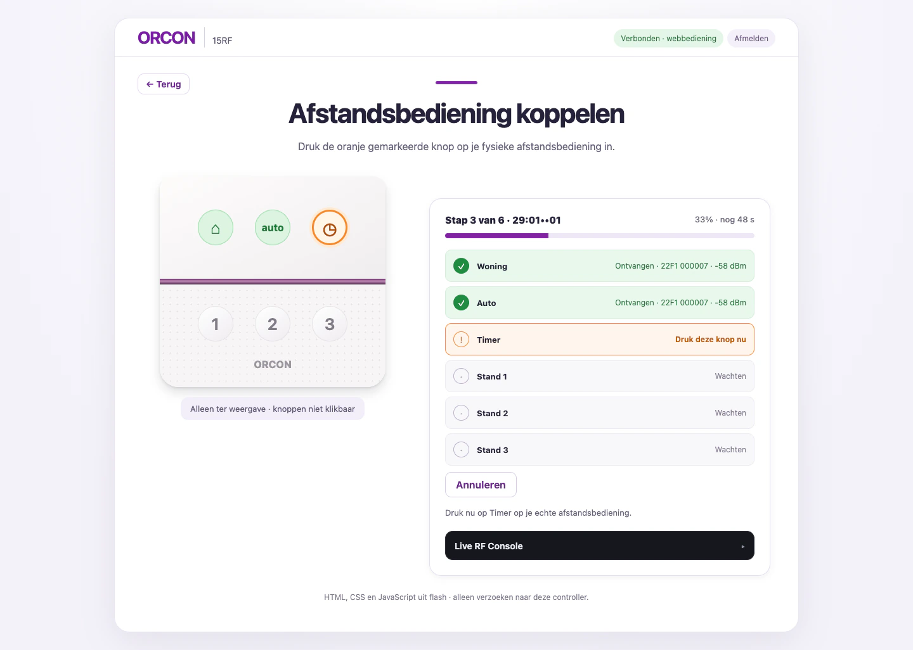

### 3. Controleer en sla het profiel op

Na alle zes knoppen toont de pagina **Uitlezen voltooid**. Controleer de lijst, vul een profielnaam in als die nog niet is ingevuld en kies **Profiel opslaan**.

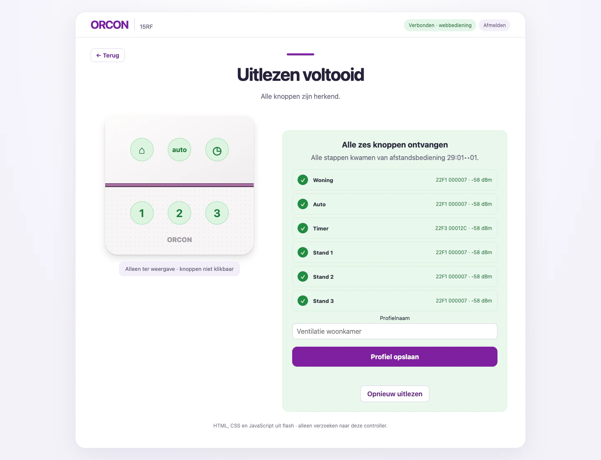

### Wordt de afstandsbediening niet gevonden?

- Controleer de batterij en druk opnieuw op een knop.
- Verminder de afstand tot de Heltec en probeer opnieuw.
- Controleer dat de radio-ontvanger actief is; zonder ontvangst kan de wizard geen voortgang tonen.
- Wacht op de volgende vraag in plaats van snel meerdere knoppen achter elkaar te drukken.
- Blijft een stap op time-out lopen, annuleer dan en begin opnieuw. Er is dan nog geen profiel opgeslagen.

Wil je daarna met de Heltec zelf bedienen, ga dan naar [Afstandsbediening simuleren](#afstandsbediening-simuleren) en klap dat hoofdstuk open.

## Afstandsbediening simuleren

<strong>Afstandsbediening simuleren — koppelen en bedienen openen</strong>

> **Ontwikkelversie.** Dagelijkse RF-bediening hoort bij de afzonderlijke build `heltec_v2_sx1276_control` en de open pull request [#10](../../pull/10). De gewone Heltec V2-build op `main` is RX-only en kan deze opdrachten niet versturen. Koppelen en bedienen zijn niet onderdeel van een officiële release.

### Wat doet de simulatie?

De Heltec gebruikt een eigen, willekeurige afstandsbedieningsidentiteit en stuurt dezelfde soort ventilatie-opdrachten als een Orcon 15RF-afstandsbediening. Hij kopieert niet de identiteit van je bestaande afstandsbediening. Na de eenmalige configuratie heb je de originele afstandsbediening niet meer nodig voor de dagelijkse bediening.

**Voor de huidige control-build moet je eerst één keer een bestaande afstandsbediening volledig uitlezen.** Uit die zes ontvangen knoppen haalt de controller de protocolgegevens voor een profiel; zonder zo'n profiel weigert hij een bedieningsopdracht. Zonder enige originele afstandsbediening kun je de huidige build dus nog niet volledig vanaf nul configureren.

De virtuele afstandsbediening kan pas bedienen nadat:

1. een volledig uitgelezen, geschikt actief profiel is gekozen;
2. de Heltec met de juiste ventilatie-unit is gekoppeld;
3. de gebruikte firmware RF-verzenden ondersteunt.

### 1. Koppel de Heltec aan de ventilatie-unit

1. Open **Simulatie instellen**.
2. Zet de ventilatie-unit in koppelmodus volgens de Orcon-instructies: haal de unit ongeveer **10 seconden** van de stroom en zet hem daarna weer aan.
3. Het koppelvenster is ongeveer **3 minuten** open.
4. Selecteer op de virtuele afstandsbediening **Auto** en **1**. De pagina maakt daarvan de combinatie **Auto + 1**.
5. Kies **Combinatie Auto + 1 verzenden**.

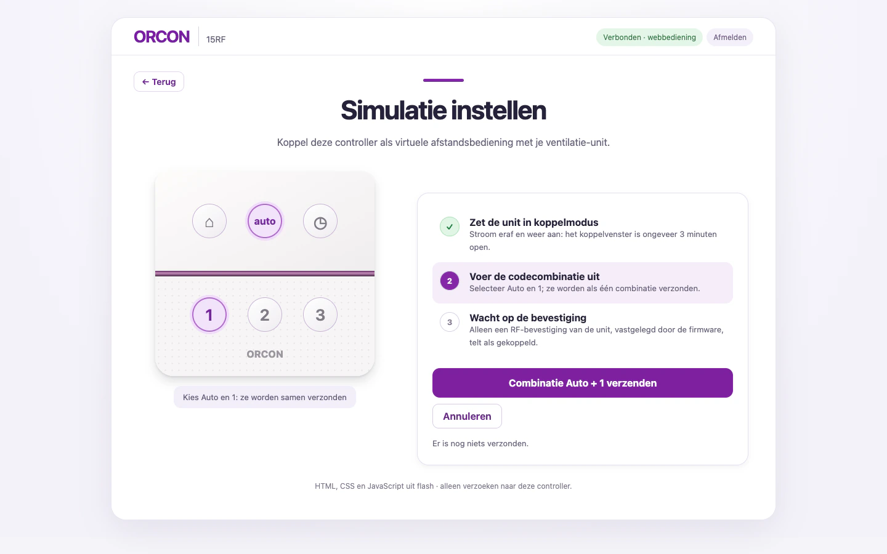

6. Wacht op bevestiging van de ventilatie-unit.

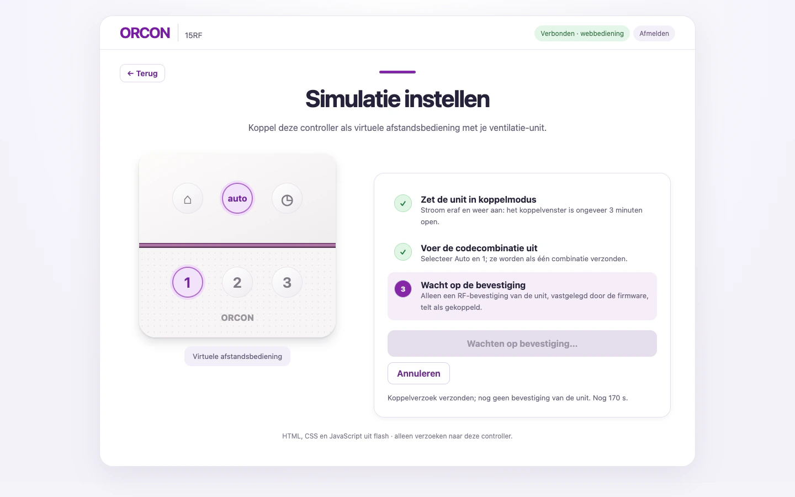

Eén klik verstuurt één koppelaanbod. De firmware herhaalt het niet automatisch. **Verzonden** betekent nog niet **Gekoppeld**: daarvoor moet de unit bevestigen én moet de firmware dezelfde unit vastleggen. Lukt dat niet binnen het venster, start dan opnieuw; een nieuwe koppelpoging vraagt geen fabrieksreset of volledige installatie.

### 2. Selecteer een profiel en open de bediening

Open **Profielen** en tik op het gewenste profiel. Het wordt **Actief** en de interface gaat terug naar het dashboard. Profielen wisselen verstuurt zelf geen RF-opdracht.

De virtuele afstandsbediening staat bovenaan het dashboard. Gebruik de grote opname voor het geheel en de uitsnede hieronder om de knoppen en status samen te bekijken.

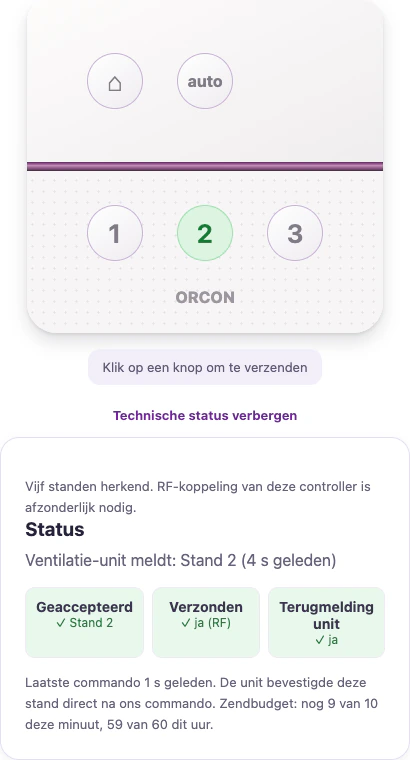

### 3. Kies een ventilatiestand

- **Woning:** de woning-/afwezigstand van het Orcon-protocol.
- **Auto:** de ventilatie-unit volgt zijn eigen automatische regeling.
- **Stand 1:** lage stand.
- **Stand 2:** middenstand.
- **Stand 3:** hoge stand.

Klik op een knop om één opdracht te sturen. In de web-control-build zijn deze vijf standen beschikbaar; **Timer** is daar niet beschikbaar. De interface houdt bovendien een minimale wachttijd en een zendbudget aan.

### Wat betekent de status?

| Aanduiding | Betekenis |
| --- | --- |
| **Geaccepteerd** | De controller heeft het verzoek gevalideerd. Er is daarmee nog niets verzonden. |
| **Verzonden** | De radio heeft het RF-pakket verstuurd. Dit bewijst niet dat de unit het heeft uitgevoerd. |
| **Terugmelding unit** | De gekozen unit heeft de gevraagde stand zelf gemeld. |

Ook een terugmelding is **geen fysiek gemeten ventilatorsnelheid**. De controller zit niet op de motor en meet geen toerental of luchtstroom. Controleer bij twijfel de werking van de unit zelf.

### Reageert de ventilatie niet?

1. Controleer of het juiste profiel **Actief** is en bij deze unit hoort.
2. Controleer of de Heltec daadwerkelijk **Gekoppeld** is; alleen uitlezen is niet voldoende.
3. Kijk naar **Verzonden** en **Terugmelding unit**, niet alleen naar de kleur van een knop.
4. Wacht de aangegeven minimale tijd tussen opdrachten en probeer niet snel achter elkaar te klikken.
5. Controleer afstand, antenne, stroomvoorziening en de stand van de unit.
6. Is de koppeling verlopen of nooit bevestigd, herhaal dan alleen de koppelprocedure.

## Profielen beheren

<strong>Profielen beheren — handleiding openen</strong>

Een profiel bewaart de gegevens van een fysieke afstandsbediening en de bijbehorende ventilatiecontext. Je kunt maximaal **vier profielen** opslaan. Er is één actief profiel voor nieuwe bedieningsopdrachten.

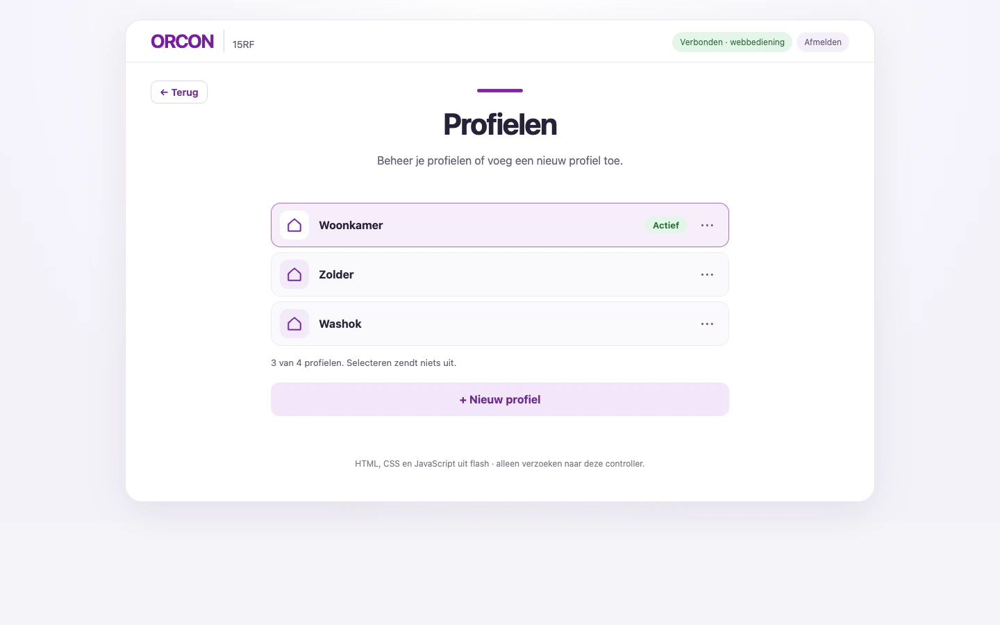

### Nieuw profiel aanmaken

1. Open **Profielen → + Nieuw profiel**.
2. Geef het profiel een unieke, herkenbare naam.
3. Kies **Volgende** en lees daarna de bestaande afstandsbediening uit.

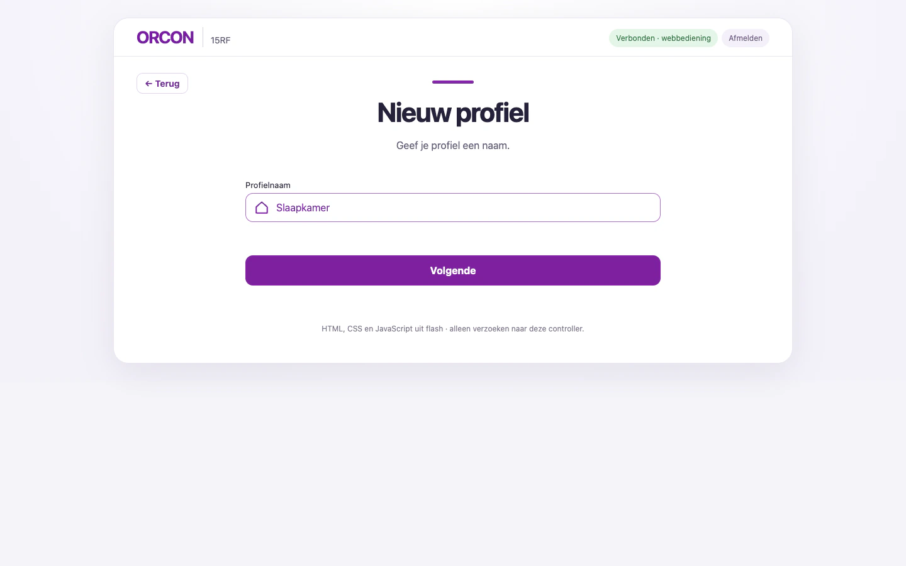

Een afstandsbediening die al bij een ander profiel hoort, wordt niet zonder meer aan een tweede profiel toegevoegd. Annuleren of een fout tijdens het uitlezen laat het oude actieve profiel behouden.

### Actief profiel selecteren

Tik op de profielkaart. De badge **Actief** verandert en het dashboard gebruikt dit profiel voor volgende opdrachten. **Selecteren zendt niets uit.**

Je kunt gegevens voor meerdere afstandsbedieningen of units bewaren, maar de huidige interface bedient ze niet gelijktijdig. Wisselen gebeurt door het actieve profiel te veranderen; er is geen apart multiroom-dashboard.

### Naam wijzigen of profiel verwijderen

1. Kies de knop **⋯** naast het profiel.
2. Kies **Hernoemen** of **Verwijderen**.
3. Verwijderen vraagt een bevestiging.

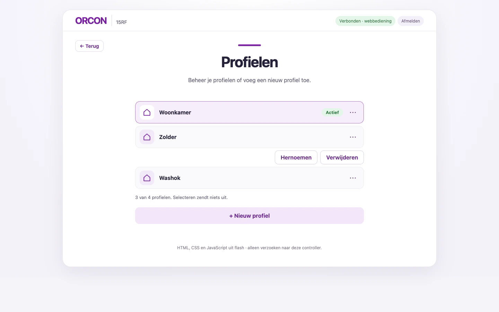

Verwijder je het actieve profiel, kies daarna een ander profiel. Verwijder je het laatste profiel, dan opent de interface opnieuw het startscherm.

### Profielgegevens en RF-koppeling zijn niet hetzelfde

- **Uitlezen en profiel opslaan:** legt vast welke afstandsbediening en knoppen zijn waargenomen.
- **Simulatie instellen:** koppelt de eigen Heltec-identiteit aan de ventilatie-unit.
- **Profiel selecteren:** kiest alleen welke gegevens de volgende webopdracht gebruikt.

Een profiel hernoemen of wisselen herstelt geen verloren RF-koppeling.

## Firmware bijwerken

<strong>Firmware bijwerken — OTA-handleiding openen</strong>

> **Ontwikkelversie, nog geen updatepakket beschikbaar.** Web-OTA met `.orconfw` staat op de ontwikkelbranch en is nog niet volledig op hardware gevalideerd. De [releasepagina](../../releases) bevat op dit moment geen officiële downloads.

Na een eerste USB-installatie met OTA-ondersteuning zijn latere updates via wifi bedoeld. Er is geen automatische updatecontrole; je downloadt en installeert zelf een bestand.

### Update installeren

**Voer deze stappen uit zodra een officiële release een bijpassend updatebestand aanbiedt.**

1. Download van de [officiële releasepagina](../../releases) het nieuwe **`.orconfw`**-bestand voor de Heltec V2. Gebruik geen factory-`.bin` in dit scherm.
2. Open de webinterface, meld je aan en ga naar **Systeem**.

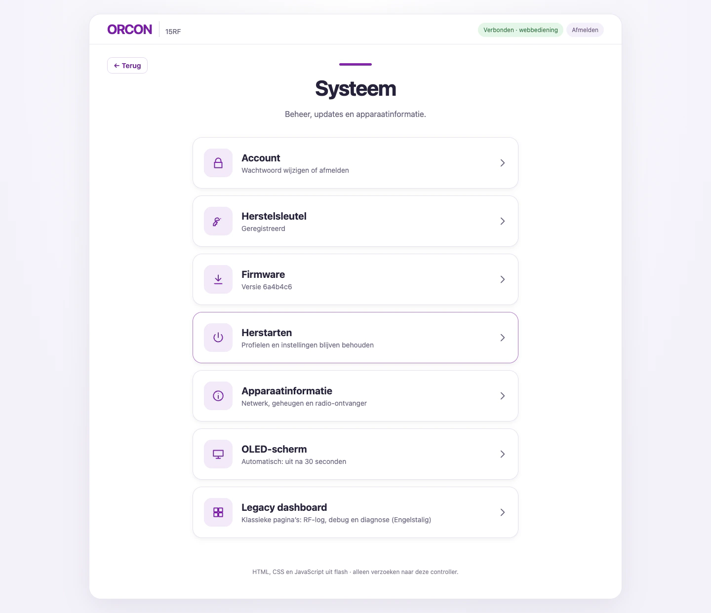

3. Open **Firmware** en kies **Update installeren**.
4. Selecteer het gedownloade `.orconfw`-bestand en start de update.

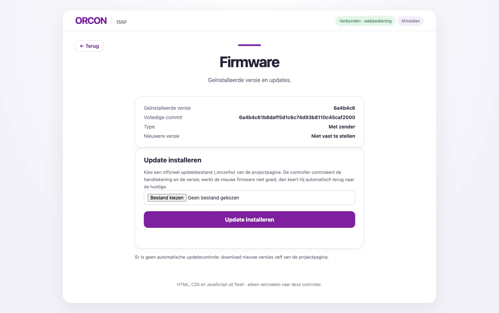

5. Laat de pagina open en wacht op de herstart en proefperiode.
6. Meld je daarna opnieuw aan en controleer onder **Systeem → Firmware** de geïnstalleerde versie.

### Wat controleert de controller?

De ontwikkelimplementatie controleert onder andere:

- de digitale handtekening van de uitgever;
- of de release niet ouder is dan de geïnstalleerde release;
- bestandsgrootte en SHA-256-hash;
- het bord, de firmwarevariant en de vereiste veiligheidsmarkeringen.

De controller installeert niets als deze controles niet kloppen. Er is geen ondersteunde instructie om handtekening-, versie- of variantcontroles te omzeilen.

### Wat gebeurt er tijdens de update?

De nieuwe firmware wordt in de niet-actieve van twee firmwareplekken geschreven. Daarna start de controller ermee op in een **proefstart**. De proefstart wordt pas definitief nadat de firmware minimaal 60 seconden draait, wifi verbonden is en de radio-ontvanger werkt.

> **Onderbreek de voeding niet tijdens schrijven, herstarten of de proefstart.** Sluit de Heltec niet zomaar af omdat het even duurt. Tijdens het schrijven kan de radio bovendien kort berichten missen.

### Wat is rollback?

Wordt de proefstart niet binnen ongeveer **5 minuten** bevestigd, bijvoorbeeld door een crash of ontbrekende wifi, dan keert de bootloader automatisch terug naar de vorige firmware. Dat heet **rollback**. Het is een herstelmechanisme, geen downgrade die je zelf via een willekeurig oud bestand kunt forceren.

Mislukt een update, controleer dan eerst bestand, netwerk en stroomvoorziening en bekijk de melding. Installeer alleen opnieuw met een ongewijzigd officieel bestand. Technische details en de afzonderlijke USB-herstelgrenzen staan in [Signed OTA en remote diagnostics](docs/OTA.md).

## Resetten en herstellen

<strong>Resetten en herstellen — handleiding openen</strong>

> **Ontwikkelprocedure — NOT TESTED op hardware.** De knopregels, herstelmodus en fabrieksreset zijn host-getest, maar het volledige OLED-menu is nog niet op een echte Heltec gevalideerd. Er bestaat geen webroute voor een fabrieksreset. Er is ook nog geen echte foto van dit menu beschikbaar; de afbeeldingen hieronder tonen alleen bestaande webpagina's.

### Het fysieke herstelmenu openen

De Heltec heeft **RST** en **PRG**.

1. Laat alle knoppen los en druk kort op **RST**.
2. Houd daarna, **binnen 20 seconden na de start**, **PRG 15 seconden** vast.
3. Na ongeveer 1 seconde verschijnt een aftelling. Laat PRG los zodra het menu opent.
4. **Kort op PRG drukken:** volgende optie.
5. **PRG 2 seconden vasthouden:** de getoonde optie kiezen.

Het menu bevat in deze volgorde **Annuleren**, **Herstelmodus**, **WiFi wissen** en **Fabrieksreset**. Na een minuut zonder invoer sluit het menu. Tijdens een OTA-proefstart zijn menu-acties geblokkeerd.

> Houd PRG **niet al vast terwijl je RST indrukt of loslaat**. Daardoor kan de ESP32 in de ROM-downloadmodus starten en blijft het scherm zwart. Laat alles los en druk dan alleen kort op RST om normaal op te starten.

### 1. Wachtwoord herstellen

Gebruik dit alleen als je het beheerderswachtwoord bent vergeten en je `orcon-recovery-key.pem` plus de bijbehorende wachtwoordzin nog hebt.

1. Open het fysieke menu en kies **Herstelmodus**. Er wordt niets gewist.
2. Verbind binnen **15 minuten** met `Orcon15RF-Setup`; het wachtwoord staat op het OLED.
3. Open **http://192.168.4.1** en kies **Wachtwoord vergeten**.
4. Kies je PEM-bestand of plak de tekst, vul de wachtwoordzin in en kies een nieuw beheerderswachtwoord.
5. Na succes worden bestaande sessies afgemeld. Meld je aan met het nieuwe wachtwoord.

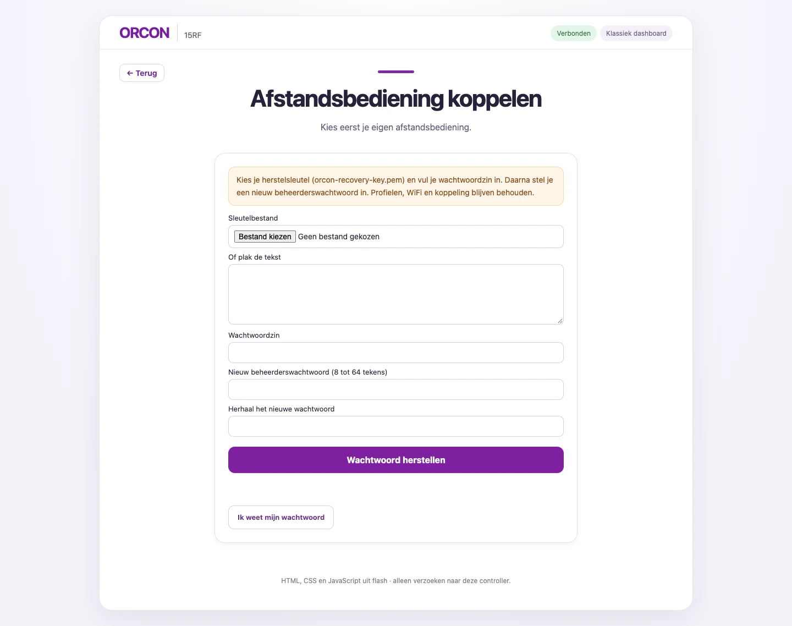

*Let op: in deze ontwikkelopname blijft boven het formulier ten onrechte de eerdere kop **Afstandsbediening koppelen** zichtbaar. Gebruik specifiek het formulier **Wachtwoord herstellen**; dit is een bestaande ruwe rand in de ontwikkelinterface.*

Weet je het huidige beheerderswachtwoord nog maar ben je de PEM kwijt, meld je dan in dezelfde fysieke herstelmodus eerst aan en maak via **Systeem → Herstelsleutel** een nieuwe sleutel. De oude sleutel werkt daarna niet meer.

### 2. WiFi herstellen

Kies bij een nieuwe router of verhuizing bij voorkeur eerst de gewone webpagina **WiFi → Nieuw WiFi-netwerk instellen**. Als dat niet meer kan:

1. Open het fysieke menu en kies **WiFi wissen**.
2. Verbind met `Orcon15RF-Setup` en open **http://192.168.4.1**.
3. Meld je aan met het bestaande beheerderswachtwoord en stel het nieuwe netwerk in.

Alleen het thuis-wifinetwerk wordt gewist. Beheerderswachtwoord, herstelsleutel, profielen, eigen RF-ID, koppelingsgegevens en firmware blijven behouden.

### 3. Volledige fabrieksreset

Gebruik dit voor overdracht aan een nieuwe eigenaar of als je bewust alles opnieuw wilt instellen. Probeer bij andere problemen eerst de gerichtere oplossing in [Problemen oplossen](#problemen-oplossen).

1. Open het fysieke menu en kies **Fabrieksreset**.
2. Laat PRG los bij de bevestigingsvraag.
3. Houd PRG daarna opnieuw **5 seconden** vast om te bevestigen. Een korte druk annuleert.
4. Wacht tot de reset en herstart klaar zijn.
5. Verbind met het nieuwe `Orcon15RF-Setup`-wachtwoord op het OLED en begin opnieuw bij [Eerste configuratie](#eerste-configuratie).

| Gegevens | Na een fabrieksreset |
| --- | --- |
| Firmware, bootloader en OTA/rollbackstructuur | Behouden |
| Thuis-wifi en setup-wachtwoord | Gewist; er wordt een nieuw setup-wachtwoord gemaakt |
| Beheerderswachtwoord | Gewist |
| Persoonlijke herstelsleutel op de controller | Gewist; het oude PEM-bestand is voor dit apparaat niet meer geldig |
| Profielen en eigen RF-ID | Gewist; een volgende koppeling gebruikt een nieuwe eigen ID |
| OLED- en overige lokale instellingen | Gewist |

**De Orcon-unit zelf wordt niet gereset.** Die kan de oude Heltec-ID in zijn eigen geheugen behouden. De geresette Heltec gebruikt die oude ID niet meer, maar het verwijderen van de oude koppeling in de unit moet volgens de instructies van Orcon op de unit zelf gebeuren.

## Problemen oplossen

<strong>Problemen oplossen — compact overzicht openen</strong>

Begin met de minst ingrijpende stap. Een fabrieksreset is alleen nodig voor overdracht, een volledig schone start of wanneer wachtwoord én herstelmiddelen allemaal ontbreken.

| Probleem | Wat kun je veilig proberen? |
| --- | --- |
| **De Heltec start niet** | Controleer de USB-voeding en gebruik een geschikte voedingsbron en datakabel. Laat PRG los en druk één keer kort op RST. Geen verbetering? Stop met willekeurig flashen en raadpleeg de technische USB-hersteldocumentatie. |
| **Het OLED blijft zwart** | Druk eerst kort op PRG: Automatisch of Uit kan het scherm tijdelijk tonen. Hield je PRG vast tijdens RST, laat dan alles los en druk alleen kort op RST. Controleer of wifi/web wel werken. |
| **Ik zie `Orcon15RF-Setup` niet** | Wacht na opstarten ongeveer 15 seconden. Controleer het OLED en druk kort op PRG voor de gegevens. Het netwerk verschijnt alleen tijdens installatie, herstel of wanneer het thuisnetwerk ontbreekt. |
| **Mijn telefoon heeft geen internet tijdens setup** | Dat is normaal bij een directe verbinding met de Heltec. Blijf verbonden en open **http://192.168.4.1**. Schakel indien nodig tijdelijk mobiele data uit als de telefoon daardoor van wifi wisselt. |
| **De website opent niet** | Gebruik tijdens setup `http://192.168.4.1`; thuis `http://orcon15rf.local` of het IP-adres uit de router. Controleer dat telefoon en Heltec op hetzelfde netwerk zitten. Gebruik expliciet `http://`, niet `https://`. |
| **Mijn wifi-wachtwoord werkt niet** | Controleer hoofdletters en spelling. Gebruik een 2,4 GHz-netwerk. Test in de wizard opnieuw; een mislukte test overschrijft de oude wizardconfiguratie niet. Verberg het netwerk niet onnodig en typ anders de SSID exact. |
| **Mijn originele afstandsbediening wordt niet herkend** | Controleer batterij, afstand en radio-ontvangst. Druk eerst één keer zodat hij in de lijst verschijnt, selecteer hem expliciet en druk daarna pas op de gevraagde knop. Start na een time-out opnieuw. |
| **De ventilatie reageert niet** | Controleer actief profiel, RF-koppeling en de drie statussen. Een verzonden pakket is geen bevestigde stand. Controleer antenne, afstand en voeding; herhaal alleen koppelen als bevestiging ontbreekt. |
| **Ik ben mijn beheerderswachtwoord vergeten** | Gebruik de ontwikkelherstelmodus met je PEM-bestand en wachtwoordzin. Voer geen fabrieksreset uit zolang dit herstelpad beschikbaar is. |
| **Ik ben mijn PEM-sleutel kwijt** | Weet je het beheerderswachtwoord nog, maak dan in de fysieke herstelmodus via **Systeem → Herstelsleutel** een nieuwe sleutel. Zijn bestand, wachtwoordzin én beheerderswachtwoord allemaal onbeschikbaar, dan resteert een fabrieksreset. |
| **Een OTA-update mislukt** | Houd de voeding stabiel. Controleer dat het een ongewijzigd, officieel `.orconfw`-bestand voor deze bord- en firmwarevariant is. Lees de melding en probeer geen controles te omzeilen. Gebruik geen `.bin` op de updatepagina. |
| **Het apparaat valt terug op vorige firmware** | Dat is de automatische rollback na een niet-bevestigde proefstart. Laat de vorige firmware starten, controleer wifi en radio en bekijk daarna pas opnieuw een geschikte update. Rollback wist geen profielen of wifi-instellingen. |
| **Het herstelmenu opent niet** | Druk eerst kort RST en houd pas daarna, binnen 20 seconden, PRG 15 seconden vast. Tijdens een OTA-proefstart kan het menu acties weigeren; wacht dan tot de proefstart is bevestigd of teruggevallen. |

Blijft een probleem bestaan? Open een [GitHub-issue](../../issues) met de firmwareversie, het bordmodel en de exacte foutmelding. Deel **geen** wachtwoorden, sessiecookies, PEM-bestanden, herstelcodes of persoonlijke netwerkgegevens.

## Technische informatie

<strong>Technische documentatie — overzicht openen</strong>

De hoofdhandleiding blijft bewust niet-technisch. De bestaande diepgaande documenten blijven de bron voor protocol, ontwerp, tests en beperkingen.

| Onderwerp | Document |
| --- | --- |
| RAMSES-II, RF-protocol en pairing | [Protocol en radio-implementatie](docs/PROTOCOL.md) |
| Webinterface, schermen en setup-API-contracten | [Installatiewizard en setup-API](docs/SETUP_WIZARD.md) |
| Dagelijkse control-build, login en RF-budget | [Productie-image voor dagelijks gebruik](docs/CONTROL.md) |
| Wizard, eigenaarssleutel, herstel en securitymodel | [Plug-and-play installatie, eigendom en herstel](docs/PROVISIONING.md) |
| Ondertekende OTA, A/B-proefstart en rollback | [Signed OTA en remote diagnostics](docs/OTA.md) |
| USB-pakketten, flashgrenzen en herstel | [Volledig lokale USB-release](docs/LOCAL_USB_RELEASE.md) |
| Testmatrix voor echte hardware | [Hardwarevalidatie van installatie en herstel](docs/HW_VALIDATIE_PROVISIONING.md) |
| Voorgenomen releasebestanden en publicatie | [Releases en GitHub-integratie](docs/RELEASES.md) |
| OLED-standen, PRG en tests | [OLED-energiebesparing](docs/HELTEC_V2_OLED.md) |
| PlatformIO-omgevingen | [`platformio.ini`](platformio.ini) |
| Hosttests | [`test/run_host_tests.sh`](test/run_host_tests.sh) |

De lokale desktopopnames zijn reproduceerbaar met [`tools/capture_readme.js`](tools/capture_readme.js). Dat script serveert de ongewijzigde `src/setup_page.html` op loopback en gebruikt fictieve API-antwoorden volgens de bestaande contracten. Het opent geen seriële poort, stuurt geen RF en neemt geen contact op met een echte Heltec.

## Projectstatus

Deze handleiding volgt de werkelijke code, maar het project heeft nog geen publieke release. De status hieronder voorkomt dat ontwikkelwerk als beschikbaar product wordt gelezen.

| Onderdeel | Status bij deze documentatie |
| --- | --- |
| Heltec V2 op [`main`](../../tree/main) | Basis met ontvangst en diagnose; de gewone `heltec_v2_sx1276`-build is RX-only |
| Beveiligde login en dagelijkse virtuele afstandsbediening | Open ontwikkel-PR [#10](../../pull/10), nog niet in `main` |
| Vierstapswizard, PEM, web-OTA en fysiek herstelmenu | Ontwikkelbranch [`feature/plug-and-play-setup`](../../tree/feature/plug-and-play-setup); host-getest, **niet op hardware gevalideerd** |
| Officiële factory- en updatebestanden | Nog niet gepubliceerd op [Releases](../../releases) |
| LAN-beveiliging | Huidige ontwikkelinterface gebruikt HTTP zonder TLS; ontbrekende LAN-versleuteling blokkeert volgens het releaseplan een definitieve release |

De hardware- en releasegrenzen zijn expliciet vastgelegd in [Hardwarevalidatie](docs/HW_VALIDATIE_PROVISIONING.md) en het [releasevoorstel](docs/RELEASES.md). Reverse-engineered, onofficieel en zonder garantie; dit project is niet gelieerd aan Orcon.

## Bijdragen en licentie

Meld fouten of verbeteringen via [GitHub Issues](../../issues). Controleer bij documentatie van een functie altijd op welke branch en in welke firmwarebuild die functie werkelijk bestaat.

- Dank en eerdere communityprojecten: [`CREDITS.md`](CREDITS.md).
- Licentie: [MIT](LICENSE).
- Gebruikershandleiding: de hoofdstukken hierboven; de compacte aanvullende installatienotities staan in [`docs/INSTALLATIE.md`](docs/INSTALLATIE.md).
